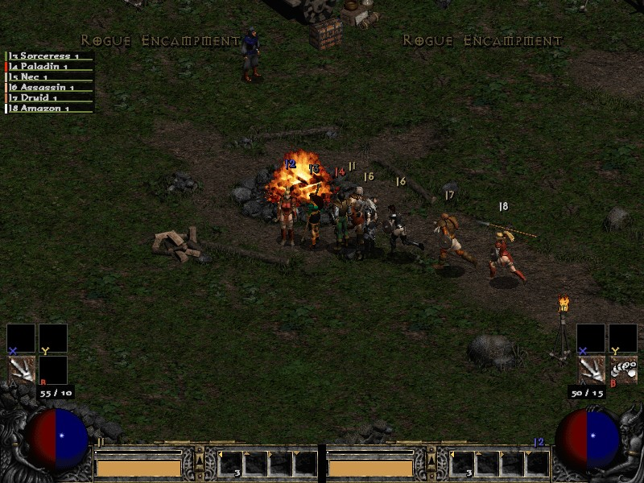
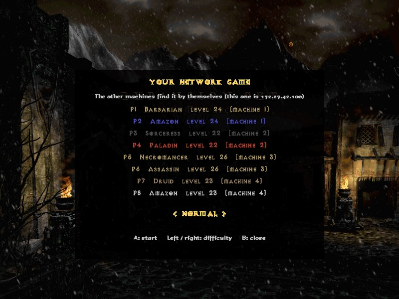
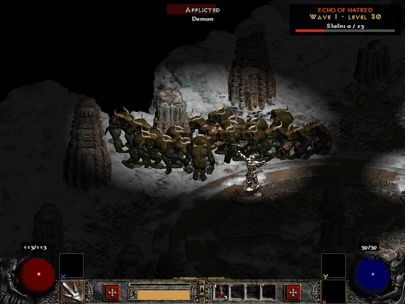
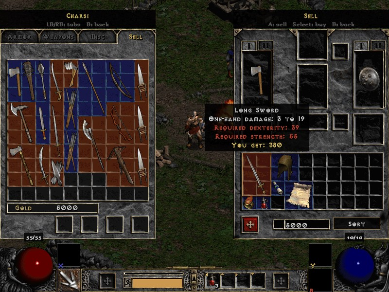
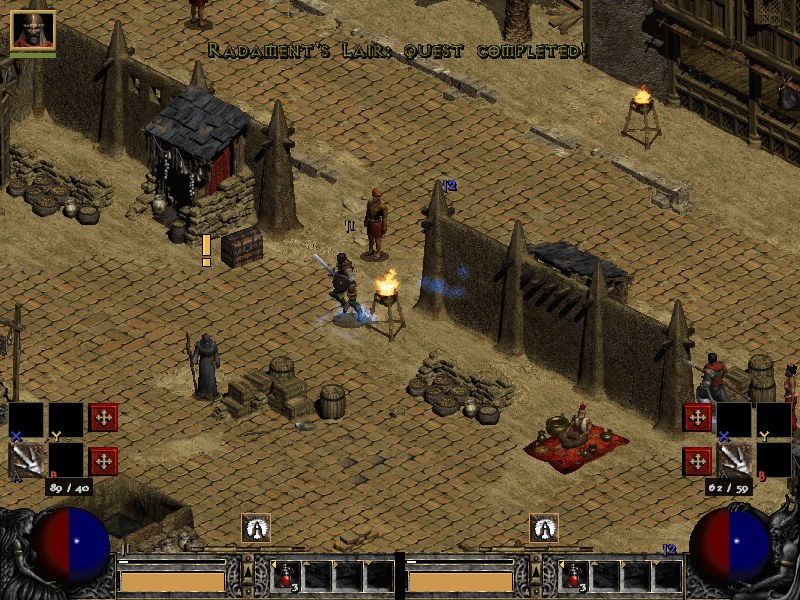
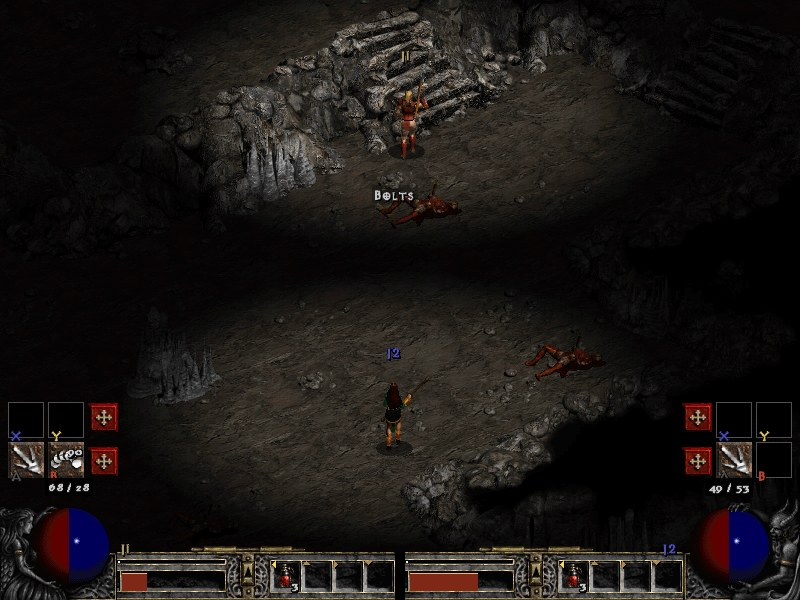
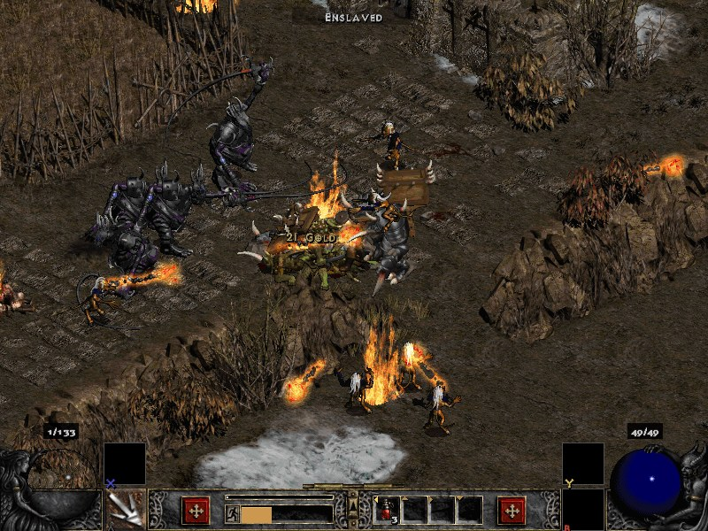
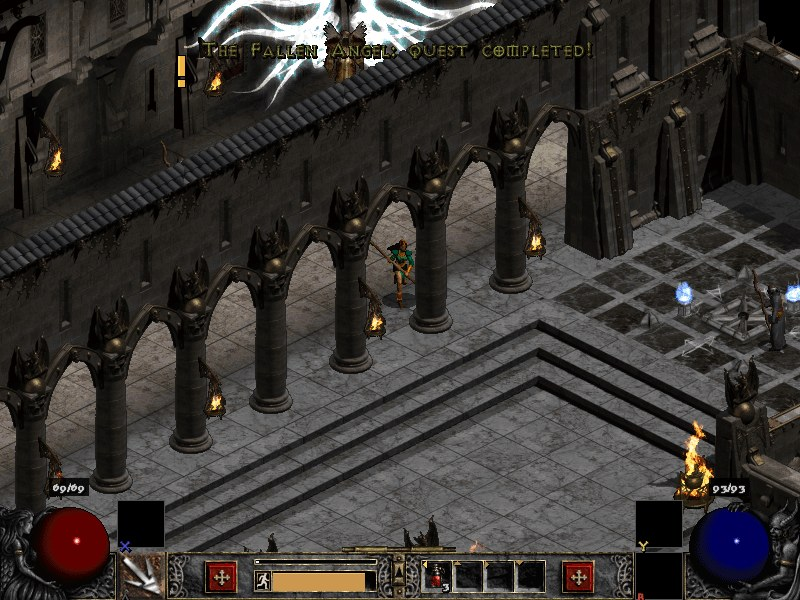
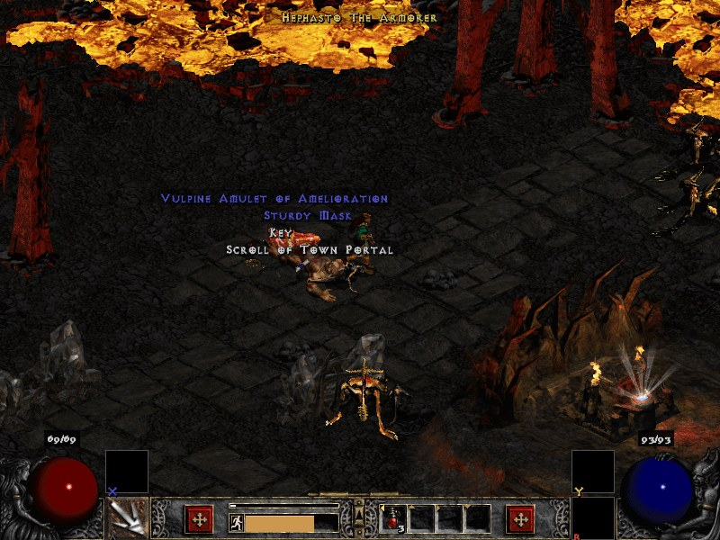
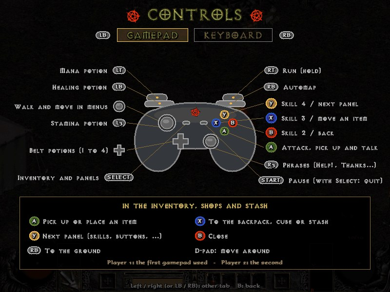

# Diablo II for Raspberry Pi (Batocera) fan-made

[](https://youtube.com/shorts/zcsaPHeL3lw)

A Diablo II–style engine **written from scratch** in C99 + SDL2, to play on
**Batocera on a Raspberry Pi 3B** with a gamepad: alone, two players on the
same screen, or **up to 8 players over the local network** (for example
four Pis with two players each). Besides the story it has its own wave
mode, the **Echo of Hatred**. It uses the graphics, maps, tables, sounds and
voices of **your own copy of Diablo II: Resurrected**, which still ships the
original game's 2D files.

> **This repository does not contain any Blizzard game file.** An importer
> copies from your Diablo II: Resurrected installation only the files the
> port uses. (The screenshots below show the port running with the game's
> art, which belongs to Blizzard.)

> **This is a work in progress.** Acts 1 to 5 are fully playable, but
> **there are still bugs to fix** (see
> [Known bugs and what is missing](#known-bugs-and-what-is-missing)). If you
> find one, please open an issue.

### Screenshots

<table>
<tr>
<td><a href="docs/screenshots/lan-8-players.jpg"></a><br>Eight players over the local network: four machines with two each (the party list, top left)</td>
<td><a href="docs/screenshots/lan-lobby.jpg"></a><br>The network lobby: the other machines find the game by themselves</td>
</tr>
<tr>
<td><a href="docs/screenshots/echo-of-hatred.jpg"></a><br>Echo of Hatred: a wave on the Arreat Summit</td>
<td><a href="docs/screenshots/shop-sell.jpg"></a><br>Shops like the original: selling from the inventory</td>
</tr>
<tr>
<td><a href="docs/screenshots/two-players-lut-gholein.jpg"></a><br>Two players on one screen (Lut Gholein)</td>
<td><a href="docs/screenshots/split-screen.jpg"></a><br>The screen splits when they move apart</td>
</tr>
<tr>
<td><a href="docs/screenshots/act5-fight.jpg"></a><br>A fight in Act 5</td>
<td><a href="docs/screenshots/pandemonium-fortress.jpg"></a><br>The Pandemonium Fortress</td>
</tr>
<tr>
<td><a href="docs/screenshots/hellforge.jpg"></a><br>The Hellforge, after Hephasto</td>
<td><a href="docs/screenshots/controls.jpg"></a><br>The controls screen</td>
</tr>
</table>

<sub>Screenshots of the port with the art of Diablo II: Resurrected's 2D mode. Diablo
II and its art are © Blizzard Entertainment; shown only to illustrate this
non-commercial fan project.</sub>

**Contents**

1. [Installing on Batocera](#installing-on-batocera)
2. [What is implemented](#what-is-implemented)
3. [What was written from scratch and what was remade](#what-was-written-from-scratch-and-what-was-remade)
4. [Differences from the original game](#differences-from-the-original-game)
5. [Known bugs and what is missing](#known-bugs-and-what-is-missing)
6. [Using the source code: build and play on a PC](#using-the-source-code-build-and-play-on-a-pc)
7. [Controls](#controls)
8. [Credits and legal notice](#credits-and-legal-notice) (MIT license)

---

## Installing on Batocera

For now: **Linux and Batocera**. A Windows importer will come later.

### Requirements

- A Raspberry Pi 3B or newer with **64-bit Batocera, v33 or newer**.
- **Diablo II: Resurrected** installed with Battle.net. On Linux it is
  installed with Wine, Lutris, Bottles or Steam (Proton); the game folder
  copied from a Windows PC works too.
- 1.7 GB free on the Pi (the port plus the imported files), plus about
  190 MB for the cinematics.
- **ffmpeg** on the computer that runs the importer, for the cinematics
  (`sudo apt install ffmpeg` or your distribution's package; Batocera
  already has it). Without it everything else is imported and the game
  works, just without cinematics.

**The whole game is not copied:** only the files the port uses (about
30,000 of them, 1.6 GB of Resurrected's roughly 40 GB), the ones listed in
`archivos.txt`. Your installation is not modified: it is only read.

### 1. Download the port

From the [**Releases**](https://github.com/rodrireddev/d2port/releases)
page, download `diablo2-port.zip` and unzip it. Inside:

| Folder | What it is |
|---|---|
| `batocera/ports/` | the port: it goes in Batocera's ports folder |
| `importador/linux/` | the importer for Linux (PC) |

`batocera/ports/` has a hidden folder, `.data/`, with the game: always copy
it together with the rest (in the file manager, Ctrl+H shows hidden files).

### 2. Import the game files

#### From a Linux PC

1. Close Diablo II: Resurrected.
2. Run the importer:

   ```bash
   cd diablo2-port/importador/linux
   ./d2port-importar
   ```

3. Choose the language (a number from the list of 13; see
   [Language](#language)). It looks for the game in
   the usual places (`~/.wine`, Lutris' `~/Games/*`, Bottles and Steam
   prefixes): if it cannot find it, it asks for the folder (you can drag it
   to the terminal). It copies the files to the same package's
   `batocera/ports`, in under a minute. Then it converts the cinematics
   with ffmpeg to a low quality the Pi can play (MPEG-1, 640x288, with the
   audio of the chosen language): a couple of minutes on a PC.
4. Copy the contents of `batocera/ports` to Batocera's ports folder,
   `/userdata/roms/ports`. For example, over the network:

   ```bash
   scp -r batocera/ports/. root@batocera.local:/userdata/roms/ports/
   ```

   (it asks for Batocera's root password), or from the file manager at
   `smb://batocera/share/roms/ports`.

You can also import straight to the Pi, if you already copied the port and
have Batocera's share mounted:

```bash
./d2port-importar --idioma enUS --destino /path/to/share/roms/ports
```

All the options: `--idioma <code>` (language: `esMX`, `enUS`, `esES`,
`deDE`, `frFR`, `itIT`, `ptBR`, `plPL`, `ruRU`, `jaJP`, `koKR`, `zhCN` or
`zhTW`), `--juego <game folder>`,
`--destino <ports folder>`, `--sin-pausa` (do not wait for Enter at the
end) and `--sin-cinematicas` (skip the cinematics).

#### On the Pi itself (coming soon)

The next release will also bring the importer for the Pi: you copy the
whole Diablo II Resurrected folder to a USB drive, plug it into the Pi and,
in the **Ports** menu, choose **Import Diablo II (English)** or **Importar
Diablo II (Español)** (the other languages, from the main menu after
importing). It is already written but not tested on a Pi yet.

### 3. Play

In Batocera's **Ports** menu, **Diablo II** (update the game lists if it
does not show up). It is played with a gamepad, alone or two players: the
first gamepad used is player 1's. See [Controls](#controls). To play with
other Pis on the same network, **LOCAL NETWORK** in the main menu (see
[Local network](#local-network-up-to-8-players)).

### Language

The port has Resurrected's **13 languages**: English, Latin American
Spanish, Spanish (Spain), German, French, Italian, Brazilian Portuguese,
Polish, Russian, Japanese, Korean, Simplified Chinese and Traditional
Chinese.

- It is chosen when importing. The importer brings that language's voices
  and cinematic sound, if your copy of Resurrected has them installed
  (Battle.net only downloads the voices of the language you play in;
  otherwise they stay in English).
- It can be changed any time in the main menu, under **LANGUAGE**: the game
  restarts in the new language. The voices stay in the imported language;
  to change them too, import again with the other language.

### Saved games, updating and uninstalling

- **Saved games** are kept in `/userdata/saves/ports/d2port`: updating the
  port or importing again does not touch them.
- **Updating:** copy the new version's `batocera/ports` over the old one.
  If the new version uses game files that were not needed before, import
  again.
- **Uninstalling:** from `/userdata/roms/ports` delete `Diablo II.sh`, the
  import entries and the `.data/d2port` folder.

### Troubleshooting

- **The game does not start:** look at `/userdata/system/logs/d2port.log`.
  If it says "no encontré data/global/palette/act1", the game files are
  missing: import them (step 2).
- **The importer says files are missing:** the list is in
  `.data/d2port/importar.log`. It is usually an unfinished game install:
  open Battle.net, let it finish installing or updating, close it and
  import again.
- **"Could not open the game files":** the game is running, the folder is
  not the Diablo II Resurrected one (it must have `.build.info` and the
  `Data` folder), or the copy is incomplete.

---

## What is implemented

**Index**

- [The acts](#the-acts)
- [The endgame](#the-endgame)
- [Echo of Hatred](#echo-of-hatred-a-new-game-mode)
- [Classes and skills](#classes-and-skills)
- [Monsters](#monsters)
- [Combat](#combat)
- [Items](#items)
- [The Horadric Cube](#the-horadric-cube)
- [NPCs, shops and mercenaries](#npcs-shops-and-mercenaries)
- [The world](#the-world)
- [The interface](#the-interface)
- [Two players](#two-players)
- [Local network (up to 8 players)](#local-network-up-to-8-players)
- [Cinematics](#cinematics)
- [Sound, music and voices](#sound-music-and-voices)
- [Languages](#languages)
- [Saved games](#saved-games)
- [Demo and automated tests](#demo-and-automated-tests)
- [Performance on the Raspberry Pi](#performance-on-the-raspberry-pi)

### The acts

The five acts, complete, in the three difficulties: **Normal**,
**Nightmare** and **Hell**. Nightmare opens after defeating Baal in Normal,
and Hell after Nightmare, as in the original; each one has its own quests,
waypoints and rewards, its monsters (levels, life, damage, resistances,
skills and treasure from the tables of that difficulty), shops,
mercenaries and the resistance penalty (-40 and -100).

- **Act 1:** the Rogue Encampment, the Blood Moor, the Cold Plains, the
  Stony Field, the Dark Wood, the Black Marsh, the Tamoe Highland, the
  Monastery, the Jail, the Cathedral and the Catacombs, with their caves
  and cellars, Tristram and the Forgotten Tower. The six quests: Den of
  Evil, Sisters' Burial Grounds (Blood Raven), The Search for Cain (the
  Inifuss tree, the Cairn Stones and Tristram), The Forgotten Tower (the
  Countess), Tools of the Trade (the Horadric Malus and Charsi) and Sisters
  to the Slaughter (Andariel).
- **Act 2:** Lut Gholein, the Sewers, the desert (Rocky Waste, Dry Hills,
  Far Oasis, Lost City, Valley of Snakes and the Canyon of the Magi), the
  Halls of the Dead, the caves, the Claw Viper Temple, the Palace, the
  Arcane Sanctuary and the seven tombs. The six quests: Radament's Lair,
  The Horadric Staff, The Tainted Sun, The Arcane Sanctuary, The Summoner
  and The Seven Tombs (Duriel and Tyrael).
- **Act 3:** the Kurast Docks (Meshif sails there and back), the jungles
  (Spider Forest, Great Marsh and Flayer Jungle), Kurast (Lower Kurast,
  the Bazaar and Upper Kurast), the Causeway, Travincal, the sewers, the
  six temples and the Durance of Hate. The six quests: The Golden Bird,
  Blade of the Old Religion (the Gidbinn), Khalim's Will, Lam Esen's Tome,
  The Blackened Temple (the High Council) and The Guardian (Mephisto).
- **Act 4:** the Pandemonium Fortress (Tyrael, Cain, Halbu and Jamella),
  the Outer Steppes, the Plains of Despair, the City of the Damned, the
  River of Flame with the Hellforge, and the Chaos Sanctuary with its five
  seals. The three quests: The Fallen Angel (Izual and his spirit), Hell's
  Forge (Hephasto, the Soulstone and the gems) and Terror's End (the seal
  bosses and Diablo, with all his skills), and Hadriel on the last bridge.
  After Diablo, Tyrael opens the last portal: the epilogue plays and it
  takes you to Act 5.
- **Act 5:** Harrogath (Larzuk, Malah, Qual-Kehk, Anya, Nihlathak and
  Cain, and the barbarian mercenaries), the Bloody Foothills, the Frigid
  Highlands, the Arreat Plateau and the Frozen Tundra with their
  barricades, the ice caves, the Arreat Summit, Nihlathak's temple, the
  Worldstone Keep, the Throne of Destruction and the Worldstone Chamber,
  and the three hells of the red portals. The six quests: Siege on
  Harrogath (Shenk and Larzuk's socket), Rescue on Mount Arreat (the 15
  prisoners), Prison of Ice (Anya), Betrayal of Harrogath (Nihlathak and
  Anya's personalization), Rite of Passage (the three Ancients) and Eve of
  Destruction (Baal's five waves, Baal and the ending cinematic).
- **The Secret Cow Level:** Wirt's body in Tristram drops his leg; with Baal
  dead, the leg and the Town Portal scrolls in the cube open a red portal in
  the Rogue Encampment to the Moo Moo Farm, with its herds of Hell Bovines
  and the Cow King in the middle of the bivouac (killing him closes the
  level for that character, as in the original).
- The original waypoints of each act, with a tab per act, and the travel
  between acts (Warriv, Meshif, Mephisto's red portal, Tyrael's portal).
- Quests follow the original logic (D2MOO's `QUESTS`): their texts, voices,
  rewards and details, like the Gidbinn altar decoy or the jade figurine
  carried by the first boss of the act.
- A quest log with the state of each quest (in the panels and in the pause
  menu).

### The endgame

- **The Pandemonium Event** (Uber Tristram), as in the original:
  - in Hell, the Countess, the Summoner and Nihlathak drop the three keys;
  - in Harrogath, the keys in the cube open a red portal to one of three
    maps: Matron's Den (Lilith), the Forgotten Sands (Uber Duriel) or the
    Furnace of Pain (Uber Izual). Each one drops its organ;
  - the three organs open Uber Tristram, with Uber Mephisto, Uber Diablo
    and Uber Baal and their minions;
  - killing them drops the **Hellfire Torch** and a Standard of Heroes for
    each player;
  - the Uber bosses have their own colors, like in the original.
- **The Token of Absolution:** the four essences (Andariel and Duriel,
  Mephisto, Diablo and Baal in Hell) make it in the cube, and using it
  gives back every skill and attribute point. Akara also does it once per
  difficulty, after the Den of Evil.
- **Diablo Clone:** sell a Stone of Jordan in Hell and "Diablo walks the
  earth": the next superunique monster you find is Uber Diablo, who drops
  **Annihilus**.
- **The Colossal Ancients** (Reign of the Warlock):
  - the act bosses drop the five Ancient statues in Hell;
  - the statues in the cube, in Act 5, open the Colossal Summit;
  - there Talic, Korlic and Madawc fight together. They call their spirits,
    have auras that lower your resistances and get stronger as they lose
    life;
  - the last one to die drops its **Colossal Jewel**.
- **Terror Zones** (Resurrected 2.5, with the Reign of the Warlock
  additions):
  - they open on each difficulty after defeating Baal there, and can be
    turned off in the difficulty screen;
  - every 30 minutes (real time) a different zone becomes terrorized. Its
    monsters are 2 levels above player 1 (up to 45, 71 or 96, depending on
    the difficulty) and give 25% more experience. They use the "terrorized"
    treasure classes, and in Hell the unique monsters get one more
    modifier;
  - a Worldstone Shard terrorizes a whole act for the rest of the game;
  - in Hell, each kill in the zone makes a **Herald** more likely to come
    hunting you. Every Herald killed makes the next one stronger, up to
    tier 5, and they drop the shards and the **Sunder charms**, which break
    a monster immunity;
  - the screen shows it all: the messages, "Terrorized" under the level
    name and under each monster's name, the zone and its minutes in the
    pause menu, and its waypoints in purple.

### Echo of Hatred (a new game mode)

A mode of its own, apart from the story, with the idea of Diablo IV's
"Echoing Hatred": endless waves in an arena. In the main menu, **ONE
PLAYER** or **TWO PLAYERS** and then **ECHO OF HATRED** (or **STORY**); it
can also be played over the local network:

- You play with a character you already have, with its equipment. The
  experience, gold and items you get go back to its saved game; its story
  (quests, acts and waypoints of the three difficulties) is not touched.
- The arena is chosen at random: the Throne of Destruction, the Arreat
  Summit, Uber Tristram or the Colossal Summit, without their monsters or
  their exits (no town portals either).
- Wave 1 has monsters of your level, and each wave is one level higher
  (past 99, they get more life and damage). They come in packs from every
  side and hunt you down; a wave is cleared by killing its quota. Every five
  waves the monsters come from another act, like the campaign.
- **The bosses:** every five waves an act boss of the story at the wave's
  level (Andariel, Duriel, Mephisto, Diablo and Baal; from wave 30 the
  Pandemonium ones: Lilith, Uber Duriel, Uber Izual, Uber Diablo and the
  three of Uber Tristram together), and on the third wave of each five a
  named boss of that act (Blood Raven, the Countess, the Summoner, Izual,
  Nihlathak...).
- **Overrun:** if the arena fills up (40 monsters alive, 50 with two
  players) for ten seconds, the run is over. Dying also ends it (with two
  players, the one who died comes back on the next wave).
- Every four waves two shrines appear, there is a well next to the start,
  and the dead mercenary comes back after each act boss.
- At the end, the **Echo chest** (more and better items the further you
  got) and a portal back to the menu. Each character keeps its best wave.

### Classes and skills

- **The seven original classes** (Barbarian, Amazon, Sorceress, Paladin,
  Necromancer, Assassin and Druid) and **Resurrected's Warlock**.
- **All their skills**, with the values of `skills.txt` and
  `skilldesc.txt`, their synergies, animations and effects, and a
  description of what each level does: Paladin auras, Necromancer curses
  and minions (skeletons, mages, golems, revives), Druid wolf and bear
  forms, Assassin traps, charges and shadows, Warlock demons and sigils,
  and all the rest.
- Attributes (5 points per level), skill points, experience and levels from
  `experience.txt`, stamina as in the original.
- The original skill tree, and a **Buttons** page to choose what each
  gamepad button does.

### Monsters

- The monsters of each level as in `levels.txt`, with their graphics,
  animations and sounds.
- **The original AI** (from D2MOO) for the monsters of the five acts:
  skeletons, zombies, ravens, fetishes, spiders, vampires, the High
  Council, the river tentacles (they submerge and come out), the monsters
  of Acts 4 and 5, the seal bosses, the Ancients, Nihlathak, Baal's waves
  and the act bosses (Andariel, Duriel, Mephisto, Diablo and Baal).
- **Random bosses** as in the original: `MonUMin` to `MonUMax` per level;
  one in five is a pack of **champions** (champion, ghostly, fanatic,
  possessed or berserker) and the rest are **uniques** with an escort (3 to
  6) and their modifiers.
- The named bosses (Corpsefire, Bishibosh, Rakanishu, the Countess,
  Radament, the Summoner…) and the original's special boss deaths.
- As in the original, each Act 4 knight carries one of four skulls in its
  hands (poison, fire, cold or unholy) and throws that kind, and the
  aura-enchanted bosses carry a Paladin aura: Lord De Seis always
  Fanaticism, Hephasto and Bremm Sparkfist a random one.
- Under the name of the monster you attack: undead or demon, champion,
  its boss modifiers and its immunities, with the game's own texts.

### Combat

- Melee and ranged attacks with the original formulas: attack rating
  against defense, block, critical strikes, elemental damage (fire, cold,
  lightning, poison and magic), resistances, life and mana steal.
- Missiles from `missiles.txt` (skills' and monsters'), with their
  graphics, sounds and area damage.
- States: poison, frozen, stunned, curses and auras.
- Death and resurrection in town. Dying costs part of the gold you carry
  (your level %, up to 20%, as in the original); your equipment and the
  gold in the stash are safe.

### Items

- **The original loot:** treasure classes, magic find and each monster's
  level. Champions and uniques have their own treasure classes, and in
  Nightmare and Hell a monster's treasure class moves up its group with its
  level, as in the original.
- **All qualities:** normal, low quality, superior, magic (blue), rare
  (yellow), unique (gold), set (green, with their partial set bonuses) and
  runewords.
- **Sockets:** gems, runes and jewels; runes in the right order make a
  runeword.
- Rings, amulets, charms, arrows and bolts, throwing weapons, potions
  (healing, mana, rejuvenation, stamina, antidote, thawing), keys and
  Town Portal scrolls.
- Strength, dexterity, level and class requirements; the fixed properties
  of class items.
- Items never wear out and drop already identified: there is no
  durability or identification, on purpose.
- **Town Portal:** a scroll (X on it in the inventory) opens a blue portal
  next to you and its pair in town; you come back through the same one and
  it closes, as in the original. Each player has their own and anyone can
  use it. There is no tome: the scrolls stack up to 20 in one slot. New
  characters start with a scroll, and Akara, Drognan and Ormus sell them
  (X in the shop fills the stack). The bots use it to go heal and shop.
- **Stash:** the chest in each town (A next to it) opens tabs of 10x6. With
  one player it opens in its own panel on the left, with the whole
  inventory on the right, as in the original: A picks an item up and puts
  it wherever you want, and X moves it between the backpack and the stash.
  With two players each one has half the screen, so it opens in place of
  the equipment, with the backpack below. You start with one tab
  and get one more for each act you reach; more can be bought with gold,
  each three times the price of the previous one (50,000, 150,000,
  450,000...), up to five. Gold can be stored too (it is not lost when
  you die).
- Inventory, equipment (two hands, shield and quiver) and belt as in the
  original, handled with the gamepad. The equipment shows on the character.

### The Horadric Cube

- It comes from the chest on the third level of the Halls of the Dead, as
  in the original.
- The `cubemain.txt` recipes: gems, runes, potions, sockets, upgrades,
  magic items and crafting.
- A **cube guide** in the pause menu, with the recipes by category and what
  each one gives (runewords included).

### NPCs, shops and mercenaries

- The NPCs of the five towns, with their dialogs and voices in the
  original order.
- **Shops** as in the original: the vendor's window on the left and your
  inventory on the right (with two players, one at a time). LB / RB switch
  the tabs; the last one, Sell (or Select), takes the cursor to your
  backpack, where A sells.
- **Gambling** (Gheed, Elzix, Alkor, Jamella,
  Nihlathak and Anya), Akara and Fara heal, **Charsi imbues** (makes an item
  rare), **Larzuk sockets** an item, **Anya personalizes** one, and Cain.
- **Mercenaries:** Kashya's rogues (Act 1), Greiz's desert warriors (Act 2),
  Asheara's Iron Wolves (Act 3) and Qual-Kehk's barbarians (Act 5), with
  their skills and auras; you can give them equipment and resurrect them.

### The world

- The original maps (`.ds1`), and the mazes and outdoor areas generated at
  random like the original does (D2MOO's `DRLG`).
- **No loading screens between areas:** each act is a single map, and areas
  are built and released one by one as you walk.
- The original collision (the 16-bit masks of each tile) and 8-direction
  pathing. Since movement here is continuous (the original stops characters
  on subtile centers), players also keep half a subtile away from the drawn
  thickness of walls, so they don't stand on top of wall bases and corners.
- The original lighting, day and night in the towns, and the roof of the
  building you are in is not drawn (as in the original), including the
  thatched huts of the Kurast Docks.
- **Automap** with the explored areas, the players, the mercenary, the
  waypoints and the exits.
- **Objects you can use** with A, as in the original (D2MOO's
  `ObjMode.cpp`): chests (locked ones take a key; the Assassin opens them
  without one), caskets, urns, barrels (some explode), corpses and hidden
  stashes, weapon racks and armor stands, bookshelves, shrines (healing,
  mana, the timed ones like armor, combat, resistances, skill and
  experience, and portal, gem, fire, monster...) and wells. Some are
  trapped (lightning, fire, poison, nova, or monsters inside). Besides the
  ones in the original maps, each room gets the random objects of its level
  (`ObjGrp` of `levels.txt` and `objgroup.txt`). What you opened stays
  opened for the whole game, also when you come back to an area.

### The interface

- The original interface (life and mana orbs, experience bar, belt,
  monster name and life), at 800x600 like the original.
- Icons of what is affecting you (buffs, auras, shrines, potions, poison,
  cold and curses), with the seconds left, above the middle of the bar.
- Inventory, skills, buttons, character, mercenary and quest panels,
  designed for the gamepad (Select opens, Y goes to the next one; Select + Y
  goes straight to the skills and Select + X to the attributes).
- A does the right thing next to something: talk, pick up, use stairs, a
  portal or a quest object.
- A pause menu with the volume, "always run", the controls, the cube guide,
  the quests and save and exit.
- A **controls screen** (in the main menu and the pause menu): the gamepad
  drawn with what each button does, and the keys of both players.
- The original chat phrases (Help!, Follow me, Thanks…) from a menu.

### Two players

- Two players on the same screen, each with a gamepad (or the keyboard).
- A single camera while they are close; when they move apart, the screen
  splits along a line perpendicular to the one joining them, and joins
  again when they get together.
- Quests, bosses and experience count for both.
- As in the original, each extra player gives the monsters 50% more life
  and experience, and they drop more often.

### Local network (up to 8 players)

- **LOCAL NETWORK** in the main menu: choose how many play on this machine
  (one or two), then **CREATE GAME** (the story or the Echo of Hatred) or
  **JOIN A GAME**: the others find it by themselves on the same network
  (Wi-Fi or cable), with its mode. Each machine has 1 or 2 players (with 2,
  its own split screen): up to 8 players, the original's maximum, for
  example four Pis with two players each.
- Everybody plays with a character from their own machine, and each
  machine saves its own characters.
- Only the controls travel over the network: every machine plays the whole
  game and they all compute exactly the same, tick by tick. Every second
  they compare a summary of the game; if one ever differs, the game stops
  and everybody's characters are saved.
- As in the original, with more players the monsters have 50% more life and
  give 50% more experience per extra player, and drop more often.
- Limits: all machines must have the same version of the port, and all
  must be Pis (or all PCs: a PC and a Pi do not round the numbers the same
  way). Everybody is in the same act, nobody can join a game that already
  started, and in a network game the pause menu does not stop the game.

### Cinematics

- The original cinematics, in low quality so the Pi plays them smoothly
  (MPEG-1 640x288 decoded with [pl_mpeg](https://github.com/phoboslab/pl_mpeg),
  colors converted by the GPU), with the audio of the imported language
  (English if your copy of the game does not have it). A, B, Start or Esc
  skips one.
- They play where the original plays them (the server's packet 0x61 in
  D2MOO's `QUESTS_ActChange` and `QUESTS_HellPortalActChange`):
  - the Blizzard logos and the **introduction** when the game starts;
  - **Act II**: the first time you travel east with Warriv;
  - **Act III**: the first time you sail east with Meshif;
  - **Act IV**: the first time you enter Mephisto's red portal;
  - the **epilogue**: when you enter the last portal after Diablo;
  - the **ending**: when you enter Tyrael's portal after Baal.
- **Cinematics** in the main menu, like the original: watch again the ones
  you have already seen. The expansion's introduction is always there: the
  original never plays it during the game either.

### Sound, music and voices

- The original sounds (`sounds.txt`, `monsounds.txt`), the music of each
  area and the ambient effects.
- The NPC voices and the class lines, in the imported language (English if
  your copy of the game does not have that language's voices).

### Languages

- **Resurrected's 13 languages**, chosen when importing or in the main
  menu: the game texts come from Resurrected in that language, and the
  engine's own texts (menus, help, descriptions) are translated into each
  one.
- Latin-script languages use the original's fonts (Polish with its own
  letters). Russian, Japanese, Korean and Chinese use Resurrected's
  TrueType fonts, drawn at the size of the original ones.
- Magic, rare and champion names are built in each language's word order,
  with the original's name formats.

### Saved games

- Six saved games, with the character, equipment, gold, mercenary, quests,
  waypoints and act.

### Demo and automated tests

- **Demo:** if the main menu is left alone for 10 seconds, two bots create
  characters (a different pair of classes each time) and play the whole
  campaign by themselves: Acts 1 to 5 in Normal, then Nightmare and Hell,
  with the same two characters and all their skills (`D2_DEMO_ACT=1` to `5`
  plays only that act).
- **Automated tests** (`--autotest act1` to `act5`): two bots play each
  act from start to end, every quest step, with 1 and 2 players. With
  `D2_ECO=1`, `--autotest eco` plays the Echo of Hatred: the waves with each
  boss, ending the run, the chest and the portal back. Today all
  five pass (68, 63, 74, 36 and 62 steps), as does the skills test (24 of
  24); the first three were also checked in English.
- **Network tests:** the same tests with several copies of the port joined
  over the network (`D2_NET_HOST` / `D2_NET_JOIN`), each machine with its
  own bots: they compare the state of the game every second. Act 1
  with 4 players on 2 machines passes (68 steps) without ever differing,
  as does the Echo of Hatred with 2 machines; 8 players on 4 machines,
  and a real Pi with three emulated ones, also stay identical.

### Performance on the Raspberry Pi

- The logic runs at 25 ticks per second like the original, with
  interpolation when drawing.
- On a Pi 3B: the logic takes 0.8 to 1.2 ms per tick and drawing 8 to 11 ms
  per frame. Areas are prepared on a worker thread so walking does not
  stall.
- A whole act fits in the Pi's 1 GB of memory.
- Over the local network with 8 players, a Pi 3B takes about 3 ms of logic
  per tick while they play together, and 7.5 to 12 ms in the worst case
  (each one in a different area), with up to 418 MB of memory. Each
  machine sends about 23 KB/s.

---

## What was written from scratch and what was remade

### Written from scratch

**All the code is new**, in C99 + SDL2: it does not use any Blizzard code.
The engine reads the game's formats (palettes, DC6, DCC, COF, DT1, DS1,
`animdata.d2`, the `.txt` tables, Resurrected's CASC storage) and does
everything else: 8-bit palette rendering with light tables, map
generation, collision, AI, combat, items, interface, sound, saving and the
bots.

### What comes from the original

From your copy of Resurrected: the 2D graphics, the maps, the game tables,
the sounds, the music, the texts and the voices.

### Remade to be faithful to the original

Several parts were remade following **D2MOO** (the reconstruction of the
original game's code) so that they behave the same:

- Random map generation (mazes, the desert, the jungles, Kurast, the Act 4
  and Act 5 outdoors, the ice caves and the Arcane Sanctuary with its
  teleport pads), and how each preset piece is laid down (its KillEdge and
  FillBlanks from `lvlprest.txt`).
- Collision, copying the 16-bit masks of each tile.
- The AI of the monsters of the five acts.
- How bosses, champions and their escorts spawn.
- The quests, with each of their steps.
- Loot, gambling and item generation.
- The drawing order of walls, roofs and characters.

What differs from the original, on purpose or because it is not done yet,
is listed in the next section.

---

## Differences from the original game

The port plays like Diablo II with the expansion (the logic follows
D2MOO), but these things are different. Most of them were chosen on
purpose, to play comfortably on a Raspberry Pi with a gamepad.

### The platform and the presentation

- **Only the classic 2D graphics**, at 800x600. Resurrected's HD world is
  3D (models, textures and skeletons, about 30 GB) and does not fit in a
  Pi 3B.
- **Played with a gamepad:** A does the right thing next to something
  (attack, talk, pick up, use a waypoint, stairs, a portal or an object), a
  Buttons page chooses what each button does, the panels are cycled with
  Select and Y, the inventory and the shops are handled with the d-pad, and
  the chat phrases are chosen from a menu.
- **Two players on the same screen**, with a split screen when they move
  apart. There is no online, LAN or Battle.net play.
- **No loading screens:** each act is a single map, built and released
  area by area as you walk.
- **The cinematics** play in low quality (MPEG-1, 640x288) so the Pi can
  decode them.
- **Six saved games**, and no Hardcore mode.
- **The language** is chosen when importing or in the main menu. The voices
  are those of the imported language.
- **The game tables are Resurrected's current ones**, not those of the old
  1.14 version: for example, every runeword can be made outside the ladder
  (patch 2.4), and the mercenaries have their newer skills.
- **The Warlock**, Resurrected's new class, is playable too. He is drawn
  with the classic sprites Resurrected ships for him (the Necromancer's),
  and his skill icons are built from the look of each skill (Resurrected
  only has HD icons for him).

### Gameplay changes, on purpose

- **Faster movement:** walking is 10% and running 20% faster than in the
  original, for the players and for the monsters (whose walking animation
  keeps pace, as in the original).
- **Faster missiles:** arrows, spells and monster missiles fly about a
  third faster than in the original, which moves them at 75% of their
  `missiles.txt` speed.
- **Potions:**
  - each belt potion has **3 sips** (the drunk part of the liquid darkens
    and the belt shows how many are left);
  - **35% fewer potions** drop from monsters and chests;
  - they **stack up to 10** per backpack slot (the original does not stack
    them); they go to the belt and the cube one at a time;
  - when a belt potion runs out, **one from the backpack takes its place**;
    if the belt has none of the kind you ask for, you drink from the
    backpack;
  - each belt slot has its own direction on the d-pad.
- **Keys stack up to 20** (12 in the original).
- **No durability and no identification:** items never wear out (there is
  no repair) and they drop already identified, so there are no Scrolls or
  Tome of Identify and Cain does not identify. Bookshelves give Town Portal
  scrolls instead of Identify scrolls.
- **No Tome of Town Portal:** Town Portal scrolls stack up to 20 in one
  slot (X on them opens the portal). Old saved games turn a tome into its
  charges as scrolls, and the Cow Level opens with Wirt's leg and a stack of
  Town Portal scrolls in the cube instead of the tome.
- **The stash has tabs** of 10x6: one at the start, one more for each act
  you reach, and up to five more bought with gold (50,000, then three times
  the previous price). Gold can be stored in it.
- **Dying:** there is no corpse to go back for; you keep your equipment.
  You lose your level % (up to 20%) of the gold you carry; the gold in the
  stash is safe.
- **The mercenary** follows closer and at your pace.
- **More information on screen:** the life and mana numbers above the
  orbs, the icons of what is affecting you (buffs, auras, shrines, potions,
  poison, cold and curses) with the seconds left, and the quest log and a
  **cube guide** (every recipe and runeword, by category) in the pause
  menu.
- **Inventory shortcuts:** RB drops the item under the cursor to the
  ground and LB sorts the backpack; there is an "always run" option.
- **Walls:** characters move continuously here (the original stops them on
  subtile centers), so players keep half a subtile away from the drawn
  thickness of walls, so they never stand on top of a wall's base.

### The endgame

- **Diablo Clone:** in the original he only came out on Battle.net, when
  the realm's servers counted enough Stones of Jordan sold by everybody.
  Here, selling one in Hell is enough.
- **Terror Zones:** the original's servers choose the order of the zones.
  Here the order comes from the seed in Resurrected's data, so it is not
  the same as on Battle.net. Each cycle of 34 turns goes through every
  zone. The Herald and Colossal Ancient rules come from the patch notes and
  guides, because that code is not public.
- **Sunder charms** break the immunity for everyone's damage in the game
  (both players, their pets and the mercenaries).
- **Local network:** the original's games are one server and its clients.
  Here every machine plays the whole game and only the controls travel (all
  of them compute the same), which is lighter for a Pi. Up to 8 players, as
  in the original, but all in the same act.
- **Echo of Hatred** is not in Diablo II: it is this port's own mode, with
  the idea of a Diablo IV mode (its exact rules are that game's). The waves,
  bosses and rewards follow the port's own rules, made with Diablo II's
  monsters, bosses, shrines and chests.

### Simplified or not done yet

- Usable objects: there are no room themes (rooms full of barrels or
  weapon racks); the exploding and poison shrines only do their damage
  (no throwing potions); the Enirhs shrine shows up as a gem shrine; the
  monster shrine turns the nearest monster into a random boss with an
  escort.
- The cold Iron Wolves do not cast Chilling Armor.
- In Act 2, the secondary border of some areas is missing.
- See also [Known bugs and what is missing](#known-bugs-and-what-is-missing).

---

## Known bugs and what is missing

**There are still bugs to fix.** The automated tests pass, but not many
people have played the game yet: there are surely more bugs than the ones
listed here. If you find one, please open an issue with what happened and,
if you can, the `d2port.log`.

**Known bugs:**

- On a Pi 3B there can be a stutter when entering the biggest areas of
  Act 3 (Spider Forest, Great Marsh): building them takes almost 100 ms.
- Some character lines are silent in Spanish: Resurrected does not ship
  that audio in Latin American Spanish.
- Many engine messages and the developer notes are written in Spanish
  first. The translations of the engine's own texts into the other 12
  languages were made for this port (Blizzard's texts come from the game):
  some may be missing or read oddly. Corrections are welcome
  (`tools/lang/<language>.txt`).

**What is missing:**

- What is listed under
  [Simplified or not done yet](#simplified-or-not-done-yet).
- The **importer for the Pi** (written, not tested yet) and for **Windows**.
- Local network play was tested with one real Pi, Pis emulated on a PC and
  PCs, not yet between two real Pis with people playing.

---

## Using the source code: build and play on a PC

The same importer injects the game files into the source tree's `data/`
folder, which git ignores. It only copies the files listed in
`tools/archivos-del-juego.txt`, not the whole game.

```bash
# Linux (Ubuntu/Debian): the compiler, SDL2 and zlib
sudo apt install build-essential cmake git libsdl2-dev zlib1g-dev
# CascLib, to read Resurrected's files
git clone https://github.com/ladislav-zezula/CascLib ~/src/CascLib
cmake -S ~/src/CascLib -B ~/src/CascLib/build -DCMAKE_BUILD_TYPE=Release \
      -DCASC_BUILD_SHARED_LIB=OFF -DCASC_BUILD_STATIC_LIB=ON
cmake --build ~/src/CascLib/build -j
# The port and the importer
cmake -S . -B build -DCMAKE_BUILD_TYPE=Release
cmake --build build -j
./build/d2port-importar      # choose the language; it finds the game and copies to data/
./build/d2port
```

The importer looks for Resurrected by itself (in Wine, Lutris, Bottles or
Steam prefixes; under WSL, the Windows one) and asks if it cannot find it.
The importer from the release package works too, with
`--destino <source folder>`.

**For the Pi** (from Linux or WSL, with the cross compiler;
`scripts/setup-wsl.sh` installs it):

```bash
cmake -S . -B build-pi -DCMAKE_TOOLCHAIN_FILE=cmake/aarch64-linux-gnu.cmake
cmake --build build-pi -j
bash scripts/package-batocera.sh     # dist/ports, with the game files (for your own use)
bash scripts/build-importador.sh     # the importer for Linux and the Pi
bash scripts/package-release.sh      # publicar/: the package without Blizzard files
```

How each part works, the tools, the tests and the debug variables are in
the [developer notes](docs/desarrollo.md) (in Spanish, like the code
comments). The plans of each act are in
[docs/plan-acto2.md](docs/plan-acto2.md),
[docs/plan-acto3.md](docs/plan-acto3.md),
[docs/plan-acto4.md](docs/plan-acto4.md) and
[docs/plan-acto5.md](docs/plan-acto5.md), and the difficulties in
[docs/plan-dificultades.md](docs/plan-dificultades.md); the measurements on
the Pi, in [docs/rendimiento.md](docs/rendimiento.md).

---

## Controls

| Action | Player 1 | Player 2 |
|---|---|---|
| Move (walking) | Left stick, WASD or holding the left mouse button | Left stick or arrow keys |
| Run (hold; with "Always run" on, it walks) | RT / R2, or left Shift | RT / R2, or right Shift |
| A button: attack or skill, pick up an item, talk | A or Space | A or Enter |
| B, X and Y buttons: skills (or Throw) | B, X, Y or E, R, F | B, X, Y or J, L, O |
| Drink the potion of a belt slot (each slot shows its arrow) | D-pad ◀ ▲ ▶ ▼, or 1 to 4 | D-pad, or 7 to 0 |
| Healing / mana potion (the first one in the belt) | LB / LT | LB / LT |
| Stamina potion | Press the left stick (L3) | L3 |
| Automap | RB / R1, or Tab | RB / R1 |
| Phrases (Help!, Follow me, Thanks…): open the list / choose / say / close | Press the right stick (R3) or C / d-pad ▲ ▼ / A / B (you can keep walking) | R3 or N / same |
| Inventory | Select or I | Select or P |
| Character (spend attribute points) | Select + X, or G (also the red cross at the bottom left of the inventory) | Select + X, or H |
| Skill tree (spend skill points) | Select + Y, or T | Select + Y, or U |
| Panels: inventory, skills, buttons, character, mercenary, quests | Select opens; Y goes to the next one | Select opens; Y goes to the next one |
| In the skill tree: learn / put on a button | A / X opens "Put on:" (the d-pad chooses the button, A assigns, B cancels) | Same |
| Buttons page: change what a button does | The d-pad chooses the button, A shows what it can have, A assigns it | Same |
| Talk to an NPC | A next to them, if no monster is right next to you (B closes) | Same |
| Open the waypoints (walking past a new one activates it) | A next to one, if no monster is right next to you (B closes) | Same |
| Use stairs or a portal | A next to it (if no monster is right next to you) | A next to it |
| Inventory: pick up / drop / use | A / X or A / X | A / X or A / X |
| Inventory: drop what you hold / put it away / sort | Y / B / LB | Y / B / LB |
| Socket a gem, rune or jewel | Pick it up with A and drop it with A on the item | Same |
| Horadric Cube: open / move items / transmute / close | X on the cube / X / A or X on Transmute / B | Same |
| Mercenary: give an item from the backpack / take it off | A (and A in the list) / X | A (and A in the list) / X |
| Shop: tabs / buy / sell (Sell tab or Select, then A on your item) | LB and RB (or the d-pad past the edge) / A / Select and A | Same |
| Character: add a point to the selected attribute | A | A |
| Pause (resume, volume, always run, controls, cube guide, save and exit) | Start or Esc | Start |
| See the controls (gamepad and keyboard) | CONTROLS in the main menu or the pause menu; left / right (or LB / RB) switch the tab, B goes back | Same |
| Cube guide: category / recipe / back | Left and right (or LB and RB) / up and down / B | Same |
| In the pause menu: change the volume or "Always run" | Left / right | Left / right |
| Quit the game | Select + Start | |

With a single player, any controller moves the character. The first
gamepad used is player 1's and the second one is player 2's (the order in
which they were connected does not matter).

---

## Credits and legal notice

- **License:** the port's code and documentation are free software under
  the [MIT license](LICENSE).
- **Diablo, Diablo II and Diablo II: Resurrected** are trademarks of
  Blizzard Entertainment. This project is not affiliated with Blizzard. The
  port does not include any game file: the importer copies them from your
  own installation, for your personal use. Do not share them. The
  screenshots in `docs/screenshots` show that art (© Blizzard Entertainment)
  only to illustrate the project; they are not covered by the MIT license.
- [**D2MOO**](https://github.com/ThePhrozenKeep/D2MOO), the reconstruction
  of the original game's code, used to keep the logic faithful (MIT; some
  tables come from it, see [THIRD-PARTY-NOTICES.md](THIRD-PARTY-NOTICES.md)).
- [**CascLib**](https://github.com/ladislav-zezula/CascLib), to read
  Resurrected's files (MIT; linked into the importer).
- [**SDL2**](https://www.libsdl.org/), for the window, sound and gamepads
  (zlib license).
